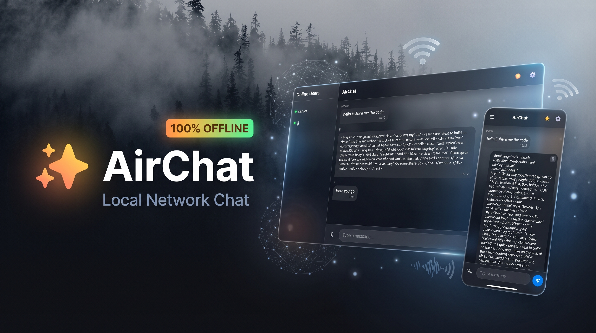
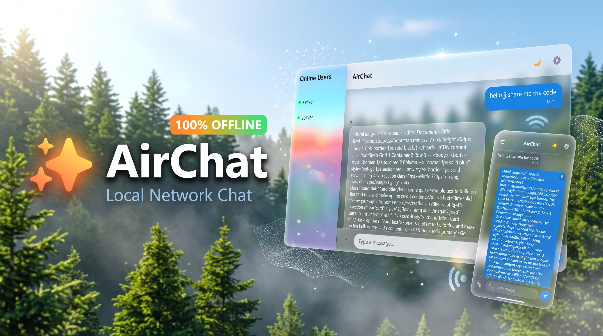

<br>

# AirChat

A tiny, offline-first LAN chat app. No server, no internet, no accounts. Just plug everyone into the same network and start talking.

Built by a student, for students — because sometimes the fastest way to share a code patch is the network you already have.

---

<p align="center">
  
  
</p>

## Why this exists

I study in a place where Wi-Fi is either broken, overloaded, or blocked. Group projects meant passing USB sticks around, shouting file names across rooms, or waiting for someone's hotspot to stop dying.

So I built AirChat: a chat app that doesn't need the internet. It runs on one laptop. Everyone else on the same network opens a link and they're in.

- No cloud. No sign-up. No data leaves your network.
- Works on a hotspot, a router, a mesh network — anywhere devices can see each other.
- The host just opens the app and shares a QR code.

It's the chat app I wish existed when I was trying to send a 200 MB patch to a friend at 1 a.m.

---

## What it does

- **Real-time chat** between any devices on the same network
- **Emoji reactions** — tap or hover to react with 👍 ❤️ 😂 😮 😢 🔥
- **Instant typing indicator** — see when someone is typing without lagging the network
- **Smart image compression** — auto-shrinks camera photos for weak hotspots (tap HD when you need the raw file)
- **Delta reconnect** — dropped Wi-Fi? Quietly reconnects and downloads only the messages you missed
- **File and image sharing** — share any file up to 20 MB (drag, drop, done)
- **Message history** — recent messages stay cached and reload cleanly
- **Light and dark themes** with matching wallpapers
- **Mobile-friendly** — designed to work on phones as well as laptops
- **QR code** in the terminal — scan from a phone, no typing IPs
- **No internet required** — ever

---

## How it works (30 seconds)

1. One person runs the app on their laptop.
2. A URL and QR code appear in the terminal.
3. Everyone else opens the URL, or scans the QR code.
4. That's it. Chat.

---

## Setup
```text
pip install -r requirements.txt
```

## Run
```text
python main.py
```

The server will print a local URL and a QR code. On the same Wi-Fi or hotspot:
- Phone: scan the QR code
- Laptop: type the URL shown in the terminal

## Notes
- The app is designed for personal hotspots or private LANs where devices can reach each other.
- Some public Wi-Fi networks enable client isolation, which prevents devices from seeing each other. AirChat will not work on those networks.
- Port 9999 must be allowed through the firewall on the host machine.

## License
MIT
